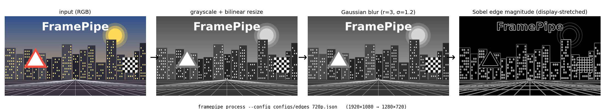
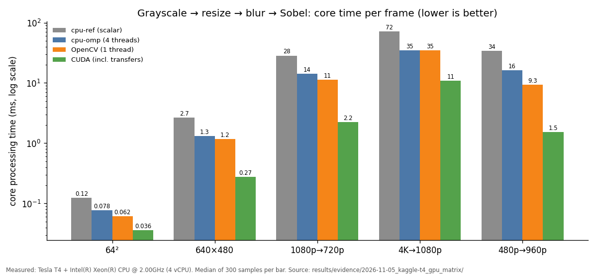
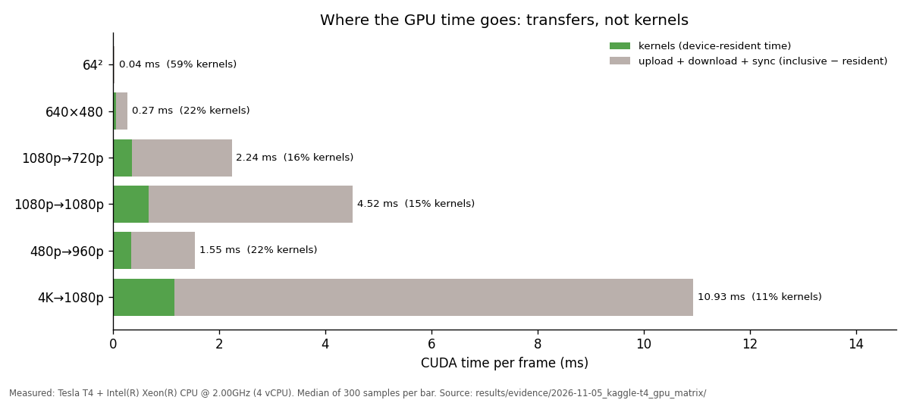
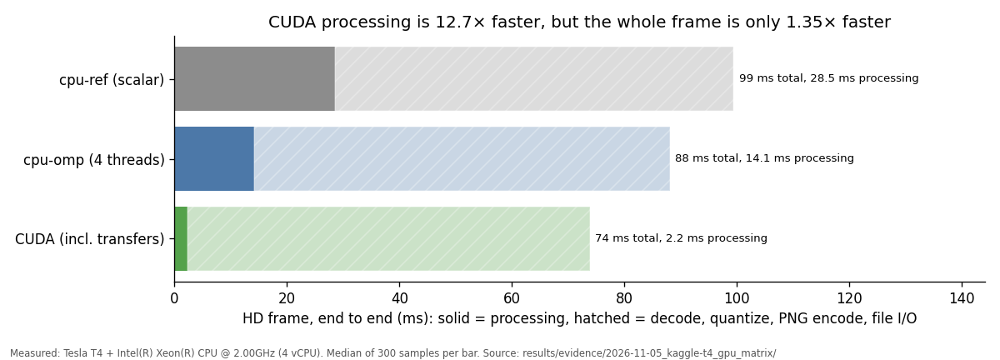

# FramePipe

[](https://github.com/shres1974/framepipe/actions/workflows/ci.yml)


[](LICENSE)
[](notebooks/reproduce_gpu.ipynb)

**A C++17 / CUDA image-preprocessing pipeline that is measured, not guessed.**
Grayscale → bilinear resize → separable Gaussian blur → Sobel edge magnitude,
implemented four ways (scalar reference, OpenMP, custom CUDA kernels, and an
OpenCV baseline) and checked against an independent NumPy oracle.



<sub>Produced by the real CLI (`scripts/make_showcase.py hero`). The edge panel is contrast-stretched for
display; the unmodified output is [docs/assets/edges_1280x720.png](docs/assets/edges_1280x720.png).</sub>

## Results at a glance

HD frame (1920×1080 → 1280×720, edges), NVIDIA Tesla T4 + 4-vCPU Xeon, median of 300 samples:

| Backend | Core processing | vs scalar | Whole frame (decode → PNG write) |
|---|---:|---:|---:|
| cpu-ref (scalar reference) | 28.5 ms | 1.0× | 99 ms |
| cpu-omp (4 threads) | 14.1 ms | 2.0× | 88 ms |
| OpenCV 4.10 (1 thread, matched semantics) | 11.3 ms | 2.5× | 83 ms |
| **CUDA, including host↔device transfers** | **2.24 ms** | **12.7×** | **74 ms** |
| CUDA kernels only (data already on GPU) | 0.36 ms | not comparable¹ | n/a |

<sub>¹ Excludes the host↔device transfers that a CPU backend never pays; shown to locate the cost, not as a speedup.</sub>

The last column is the honest one: **a 12.7× faster core gives a 1.35× faster
application**, because PNG decode and encode dominate. On the GPU, 84% of the
time is transfers, not kernels. The project measures both and reports them
separately instead of quoting the best number.

| | |
|---|---|
|  |  |



Every number above is read from committed evidence
([results/evidence/](results/evidence/)) by `scripts/make_showcase.py figures`; full tables,
caveats, and the CPU laptop matrix are in [docs/benchmark_results.md](docs/benchmark_results.md).

## Engineering highlights

- **Independent oracle.** A separate NumPy implementation of the
  [numerical contract](docs/numerical_contract.md) checks every backend
  (144 comparisons on the T4, 0 failures). The oracle is itself
  mutation-checked: flipping the Sobel-y sign breaks 10 comparisons,
  `floor`→`trunc` breaks 9, and changing one grayscale weight by 1/256 breaks 36.
- **GPU correctness beyond parity.** Compute Sanitizer memcheck, racecheck,
  initcheck, and synccheck all report 0 errors. The hardware tests cover
  launch boundaries, odd sizes, cropped views, and pinned vs pageable transfers.
- **Bit-exact CPU parallelism.** The OpenMP backend is byte-identical to the
  scalar reference (tested), so speedups never trade away correctness.
- **Resource discipline.** Zero device and host allocations in steady state
  (tested with fault injection), bounded batch queues, and explicit
  device-memory budgets.
- **Honest benchmarking.** Timing scopes (kernel, transfer-inclusive,
  application, startup, batch) are never mixed. Each backend is parity-checked
  before it is timed. Raw samples, environment, config hash, and git revision
  are recorded and validated against a JSON schema. Null results, such as
  transfer/compute overlap giving no end-to-end gain, are published as null
  results.
- **No silent fallbacks.** Asking for `--backend cuda` on a machine without a
  GPU exits with code 4 and writes nothing. `auto` records why it chose what it chose.
- **CPU build never needs CUDA.** CI runs Debug, Release, ASan+UBSan, oracle,
  benchmark-schema, and CUDA-compile jobs.


## What it is for

It turns frames such as a 1920×1080 camera sequence into 1280×720 grayscale,
blurred, or normalized edge-map PNGs, in manifest order, with machine-readable
correctness and timing reports. It does not make robotics decisions.

**Status:** CPU-validated and GPU-validated on an NVIDIA Tesla T4 (Kaggle,
CUDA 13.0): all 11 CUDA hardware tests, the NumPy oracle suite, and Compute
Sanitizer pass. See [docs/implementation_status.md](docs/implementation_status.md).

## Try it with Docker (CPU, no local dependencies)

```bash
docker build -t framepipe .        # builds pinned deps, runs the full test suite (~6 min first time)
docker run --rm framepipe doctor
docker run --rm --user "$(id -u):$(id -g)" -v "$PWD:/work" framepipe process \
  --input /opt/framepipe/fixtures/checkerboard_rgb.png --output edges.png \
  --config /opt/framepipe/configs/edges_720p.json --width 320 --height 240
```

To reproduce the GPU numbers on a free T4, open
[notebooks/reproduce_gpu.ipynb](notebooks/reproduce_gpu.ipynb) on Kaggle or Colab.

## Quick start (Linux, no root, no GPU required)

```bash
# 1. Tools (pinned) in a project virtualenv
python3 -m venv .venv && .venv/bin/pip install -r requirements.txt
export PATH="$PWD/.venv/bin:$PATH"
#    If `python3 -m venv` fails (no ensurepip), use:
#    python3 -m venv --without-pip .venv && curl -sS https://bootstrap.pypa.io/get-pip.py | .venv/bin/python

# 2. C++ dependencies (OpenCV 4.10, GoogleTest 1.15.2, nlohmann/json 3.11.3), ~4 min
scripts/install_deps.sh                  # installs to ~/.local/framepipe-deps
export FRAMEPIPE_DEPS=$HOME/.local/framepipe-deps

# 3. Build and test (CPU only; the default build never needs CUDA)
cmake --preset cpu
cmake --build --preset cpu
ctest --preset cpu

# 4. First commands
build/cpu/bin/framepipe doctor
build/cpu/bin/framepipe process \
  --input tests/fixtures/checkerboard_rgb.png \
  --output outputs/checkerboard_edges.png \
  --config configs/edges_720p.json --backend cpu-ref \
  --report outputs/checkerboard_report.json
```

`configs/edges_720p.json` is the documented default configuration
(edges, 1280×720, radius 3, sigma 1.2). The equivalent raw CMake invocation
without presets is:

```bash
cmake -S . -B build/cpu -G Ninja -DCMAKE_BUILD_TYPE=Release \
  -DFRAMEPIPE_ENABLE_CUDA=OFF -DFRAMEPIPE_BUILD_TESTS=ON -DCMAKE_PREFIX_PATH=$FRAMEPIPE_DEPS
cmake --build build/cpu --parallel && ctest --test-dir build/cpu --output-on-failure
```

## Commands

Every command supports `--help`. Diagnostics go to stderr; stdout carries
only requested JSON. Exit codes: 0 ok, 2 bad arguments/config, 3 I/O or
unsupported format, 4 backend unavailable, 5 processing/resource failure,
6 correctness failure.

| Command | Example |
|---|---|
| `doctor` | `framepipe doctor --json` — build capabilities and runtime usability, reported separately |
| `process` | `framepipe process --input in.png --output out.png [--config F] [--backend auto\|cpu-ref\|cpu-omp\|cuda] [--output-stage resize\|blur\|edges] [--width W --height H --radius R --sigma S --threads N] [--report F\|-] [--overwrite]` |
| `batch` | `framepipe batch --manifest frames.jsonl --output-dir out/ [--continue-on-error] [--decode-threads N] [--queue-capacity N] [--sync-write]` |
| `validate` | `framepipe validate --input in.png --candidate cuda --reference cpu-ref --report v.json` or `--reference oracle:DIR` |
| `benchmark` | `framepipe benchmark --manifest m.jsonl --backends cpu-ref,cpu-omp,opencv-cpu,cuda --scopes host_processing,device_pipeline,application,startup,batch --output-dir results/local/run1` |

Configuration precedence: built-in defaults < `--config` JSON < explicit
flags. Unknown JSON fields and unsupported values are errors. Schema:
[configs/pipeline_config.schema.json](configs/pipeline_config.schema.json).

Input policy: 8-bit gray or RGB PNG/JPEG. 16-bit, float, and alpha images are
rejected (not converted). EXIF orientation is ignored; pixels are processed
in stored order. Outputs are never overwritten without `--overwrite`, and an
output path may not resolve to the input.

Batch manifests are JSON Lines, one frame per line, processed in file order:

```json
{"frame_id": "cam0_000123", "path": "frames/000123.png", "source_timestamp_ns": 1730000000000000000}
```

## CUDA build (on a machine with a supported NVIDIA GPU and driver)

```bash
cmake --preset cuda                 # CMAKE_CUDA_ARCHITECTURES=native
cmake --build --preset cuda
build/cuda/bin/framepipe doctor     # cuda must show usable=yes
ctest --test-dir build/cuda --output-on-failure
```

Without a visible GPU, compile-only checking uses `--preset cuda-compile`
(explicit architectures 75;86;89; change them for your device).
`FRAMEPIPE_ENABLE_CUDA=ON` fails clearly if no CUDA compiler is found or no
architecture is given. Check that your toolkit supports your host compiler.

## Documentation

| Document | Answers |
|---|---|
| [docs/numerical_contract.md](docs/numerical_contract.md) | What each operator computes, exactly |
| [docs/architecture.md](docs/architecture.md) | Who owns buffers, where work happens, one frame traced end to end |
| [docs/testing.md](docs/testing.md) | Fixtures, oracle, test matrix, GPU diagnostic commands |
| [docs/benchmark_method.md](docs/benchmark_method.md) | What each metric includes and how to reproduce a run |
| [docs/benchmark_results.md](docs/benchmark_results.md) | What was measured, on which hardware, and what is still unknown |
| [docs/implementation_status.md](docs/implementation_status.md) | Milestones, requirement traceability, exact commands run, open gaps |
| [docs/decisions/](docs/decisions/) | Dependency, error-model, CLI, and scope decisions |
| [docs/writeup.md](docs/writeup.md) | The story behind the numbers: why 12.7× faster kernels give a 1.35× faster app |
| [CHANGELOG.md](CHANGELOG.md) | What each version contains |

To regenerate the README images: `python3 scripts/make_showcase.py all --framepipe build/cpu/bin/framepipe`.
The terminal GIF is rendered from [docs/demo.tape](docs/demo.tape) with VHS (instructions in the file).


## License

[MIT](LICENSE). See [THIRD_PARTY_NOTICES.md](THIRD_PARTY_NOTICES.md) for
dependencies and their licenses.
