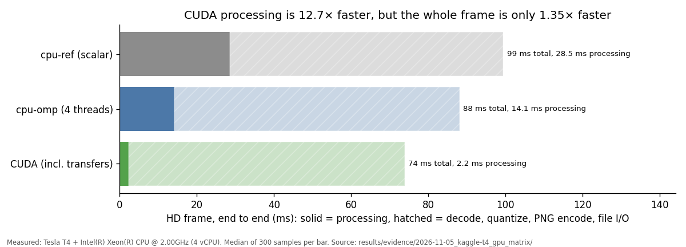
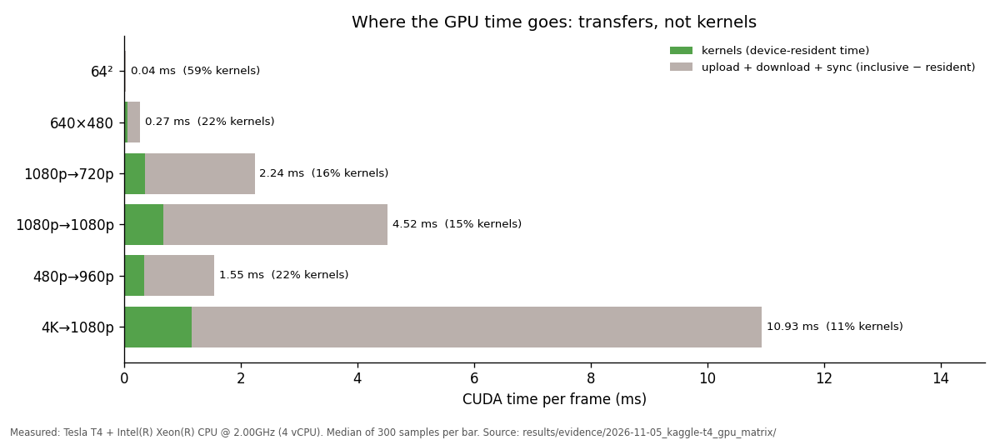
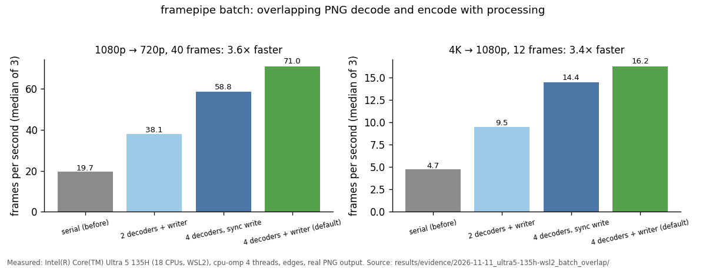

# My CUDA kernels are 12.7× faster. My application is 1.35× faster.

*What I measured building FramePipe, a C++17/CUDA image-preprocessing pipeline, and why the headline number is the wrong one.*

FramePipe does four things to each camera frame: grayscale, bilinear resize,
separable Gaussian blur, and Sobel edge magnitude. It is the kind of
preprocessing that sits in front of almost every vision model. I implemented it
four ways: a scalar CPU reference, an OpenMP backend, custom CUDA kernels, and
an OpenCV baseline with matched semantics. Then I measured all of them on an
NVIDIA Tesla T4.

## The number everyone quotes

On a 1920×1080 → 1280×720 frame, the scalar CPU reference takes **28.5 ms**.
The CUDA backend, *including* uploading the frame and downloading the result,
takes **2.24 ms**. That's 12.7×. With the data already on the GPU, the kernels
take 0.36 ms, which would make a tempting "79×" headline.

## The number that matters

Reading a PNG, decoding it, processing it, and writing the PNG result takes
**99 ms** on the CPU reference and **74 ms** with CUDA. That's 1.35×.

The processing was never the bottleneck. PNG decode and encode were. Making the
fast part 12.7× faster shrinks the frame from 99 ms to 74 ms, and no kernel
work can take it lower than the ~72 ms of I/O. This is Amdahl's law, and I
could only see it because the benchmark harness keeps its timing scopes apart:

| Scope | What it includes |
|---|---|
| `gpu_device_pipeline_ms` | kernels only, data resident on the device |
| `gpu_transfer_inclusive_wall_ms` | upload + kernels + download, host wall clock |
| `cpu_core_wall_ms` | the same work on a CPU backend |
| `application_wall_ms` | read, decode, process, quantize, PNG encode, write |
| `batch_wall_ms` | a whole manifest through the bounded queue |

If all of these had been one "time" column, I'd have reported a speedup the
user would never see.

## Inside the GPU time: transfers, not kernels

Of the 2.24 ms, only 16% is kernel time. The rest is moving bytes across PCIe.
At 4K it is 89% transfers. Even raising the Gaussian radius from 1 to 15 adds
only about 0.15 ms of kernel time.

So the obvious optimization, a shared-memory tiled Gaussian, would speed up
the smallest slice of the bar. I tried the optimizations aimed at the bigger
slices and measured them on the T4. Both live on branches
(`opt/fuse-grayscale-resize`, `opt/cuda-overlap`), with results in
[benchmark_results.md](benchmark_results.md):

- **Fusing grayscale into resize** removes a full-image device round trip. It
  is correct (parity, oracle, and Compute Sanitizer all pass) but makes no
  measurable end-to-end difference.
- **Overlapping transfers and compute across frames** (multi-slot streams with
  pinned staging) is also correct. It changed batch wall time by about 1%,
  which is within noise. Hiding a ~2 ms transfer cannot move a ~65 ms frame.

I published both as null results. A benchmark that only reports wins isn't
telling you much.

## How I know the outputs are right

Speed is easy to get if you're allowed to be wrong, so most of the effort went
into correctness:

- **A written numerical contract.** [numerical_contract.md](numerical_contract.md)
  defines each operator exactly: integer grayscale weights, half-pixel resize
  with replicate borders, the normalized Gaussian, and Sobel scaling. Each
  backend gets a documented tolerance.
- **An independent oracle.** A separate NumPy implementation checks every
  backend. On the T4 that's 144 comparisons, with 0 failures.
- **Testing the tests.** I deliberately broke the C++ code and checked that the
  oracle noticed. Flipping the Sobel-y sign broke 10 comparisons, `floor` →
  `trunc` broke 9, and changing one grayscale weight by 1/256 broke 36.
- **Compute Sanitizer.** memcheck, racecheck, initcheck, and synccheck report
  0 errors on the CUDA tests.
- **Bit-exact parallelism.** The OpenMP backend is byte-identical to the scalar
  reference, so threading never trades away correctness.
- **No silent fallbacks.** `--backend cuda` on a machine without a usable GPU
  exits with code 4 and writes nothing. `auto` records why it picked what it
  picked.

## What the CPU side taught me

At radius 15, single-threaded OpenCV beat my 12-thread OpenMP backend. More
threads were never going to close that gap. The profile showed the two
Gaussian passes at 58% of scalar time, so I restructured them into unit-stride
loops the compiler auto-vectorizes (`opt/simd-gaussian`), kept the tap order,
and verified the output is bit-identical. Separately, a thread sweep found a sharp latency cliff
as the thread count approached the VM's logical CPU count. Changing the
scheduling smoothed the tail but did not remove the cliff, and the docs say so.

## Takeaways

1. **Measure the whole application before optimizing kernels.** Here the
   kernels were about 0.5% of the frame.
2. **Keep timing scopes separate and labeled.** "Kernel time" and
   "application time" are different claims.
3. **Build an independent oracle and mutation-test it.** Parity between two
   backends you wrote yourself can hide a shared bug.
4. **Publish null results.** They tell the next person where *not* to look.
5. **Then fix the bottleneck you measured.** Here that was threads and a
   queue, not a faster kernel.

The next real win was always going to be the I/O path, so I built it.

## Fixing the actual bottleneck

Decoding a 1080p PNG took ~35 ms on the laptop, and a 4K PNG ~145 ms.
Processing took 2–5 ms. One decoder thread therefore capped `batch` at about
1/decode-time, no matter how fast the kernels were. The fix is plain
systems work, not CUDA:

- **Several decoder threads** claim frame numbers in order and may finish out
  of order.
- **A bounded reorder window** hands frames back in manifest order. A decoder
  must reserve its slot before it starts, so memory stays bounded however
  many decoders run.
- **A writer thread** PNG-encodes frame *N* while frame *N+1* is processed.

HD went from 19.7 to 71 frames per second, and 4K from 4.7 to 16.2. That's
3.4–3.6× on the CPU alone, more than the GPU ever achieved end to end. The
outputs are byte-identical to the serial path, and the threading code passes
ThreadSanitizer. One measurement changed the design: four decoders with a
two-slot window ran at ~35 fps, because decoders sat idle waiting for a slot.
The default window therefore always covers every decoder.

---

Code, evidence, and a one-click T4 reproduction notebook:
[github.com/shres1974/framepipe](https://github.com/shres1974/framepipe).
Every number in this post is read from committed benchmark evidence under
`results/evidence/`.
