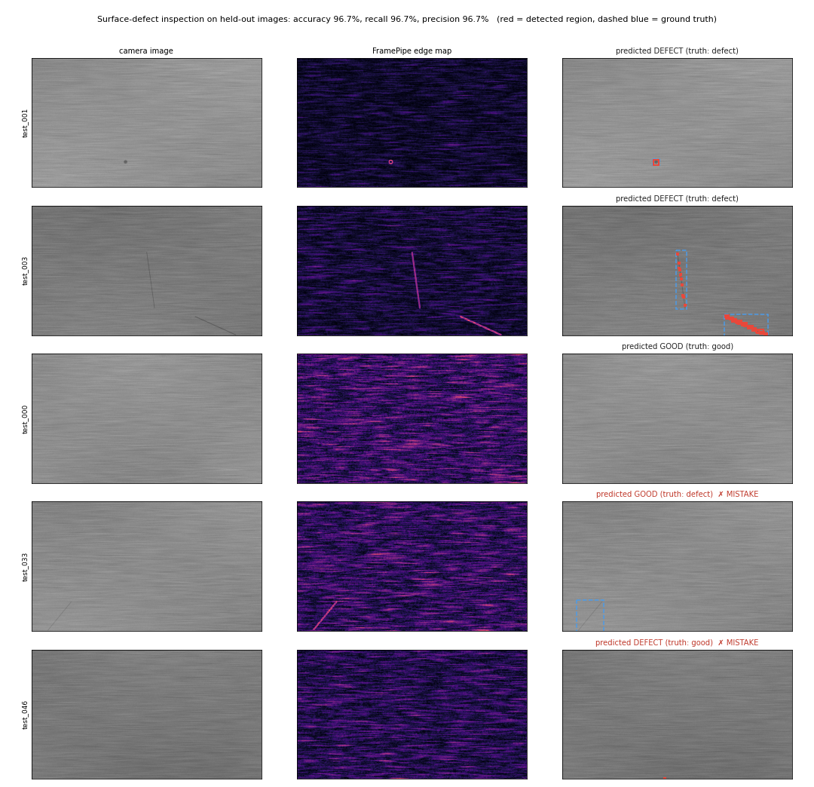

# Example: surface-defect inspection

This example uses FramePipe's edge maps as the front end of a simple
quality-control check: *does this metal surface have a crack, scratch, or
pit?*



```bash
python3 examples/defect_inspection/make_samples.py build/insp            # 120 labeled images
python3 examples/defect_inspection/run_inspection.py \
  --framepipe build/cpu/bin/framepipe --samples build/insp --out build/insp/out \
  --figure build/insp/summary.png
```

```
inspection: 60 held-out test images; threshold edge level > 13, min area 1 px (calibrated on train, train accuracy 100.0%)
  confusion   TP 29  FP 1  TN 29  FN 1
  accuracy 96.7%  precision 96.7%  recall 96.7%  defects localized 44/45
  framepipe cpu-ref: 155.7 images/s (decode + edges + PNG write)
```

## How it works

1. **Data.** `make_samples.py` renders brushed-metal surfaces with
   streaks, uneven lighting, and sensor noise. Half of them get one or two
   defects of known position. Everything is procedural with a fixed seed,
   so there's no third-party data and the run is reproducible.
2. **FramePipe.** `run_inspection.py` runs the real
   `framepipe batch` CLI on both splits. The pipeline is grayscale → resize
   → Gaussian blur → Sobel edge magnitude. The blur suppresses sensor
   noise; Sobel turns a thin dark crack into a bright line.
3. **Calibration on train only.** A grid search over the edge threshold
   (in 8-bit levels, since outputs are PNGs) and the minimum region size
   picks the rule with the best train accuracy.
4. **Held-out test.** Pixels above the threshold are grouped into
   8-connected regions. Any region of at least the minimum size means
   "defect", and its bounding box is the location.

## What the mistakes show

- **Missed scratch (`test_033`).** A faint scratch in a corner of the
  image. Its edge response barely exceeds the brushed-metal texture.
- **False alarm (`test_046`).** A small region on the bottom image border.
  Edge filters with replicated borders can respond at the edge of the
  frame. A real system would mask a border margin or crop the region of
  interest.

## Limits

The detector is a threshold, which makes it easy to explain but crude. The
images are synthetic, so 96.7% here says nothing about a real production
line. On a real line you would calibrate on real labeled images, and
probably feed FramePipe's output into a learned classifier. FramePipe's role
is the fast, verified preprocessing in front of that step. It's the same
pipeline whose CPU/GPU parity and throughput the rest of this repository
measures.
